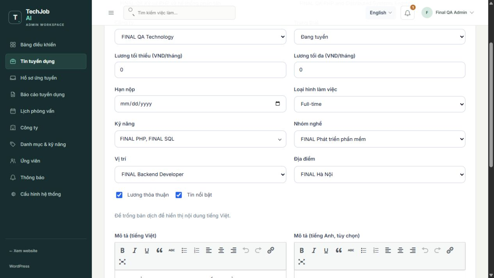
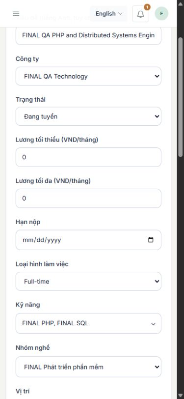
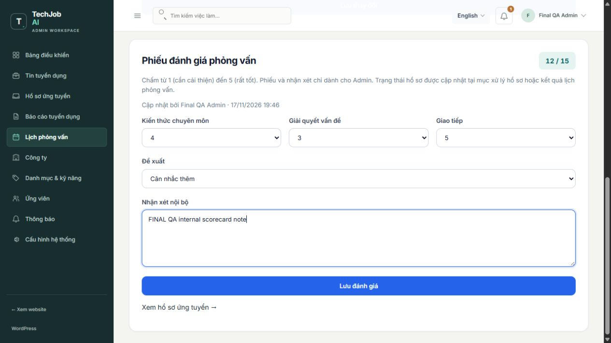
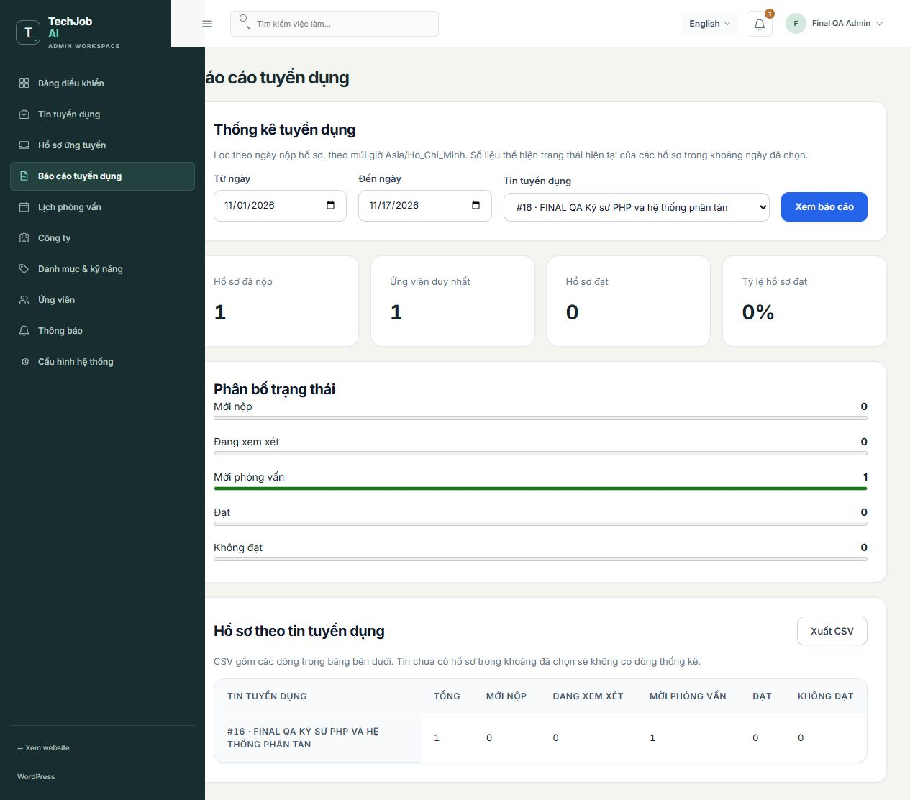

# Kết quả rà soát cuối — 17/11/2026

Nhánh bàn giao: `final-project`, tiếp nối các commit sửa E2E, ba chức năng tuyển dụng và cân chỉnh bốn ô danh mục. Tài liệu này cập nhật kết quả của lượt nghiệm thu cuối; các báo cáo trước giữ lại làm lịch sử.

## Môi trường và cách chạy

- Docker cô lập: project `techjob-final-qa`, http://localhost:18783/, WordPress 7.1.4, PHP 8.3.36, MariaDB 11.4.13. Database mới, không seed demo.
- Kiểm tra trình duyệt trên bản portable cô lập: http://127.0.0.1:18782/, WordPress 7.1.4, PHP 8.2.12, MariaDB 10.4.32. Dùng công ty, tài khoản và CV hư cấu có dấu FINAL QA.
- Bản portable localhost:18781 và dữ liệu người dùng có trước lượt này được giữ nguyên.

~~~powershell
.\scripts\setup.ps1 -ProjectName techjob-final-qa -Port 18783 -SkipDemo
.\scripts\test.ps1 -RecruitmentOnly
.\scripts\package.ps1
~~~

Đã chạy setup mới thành công rồi chạy lại cùng lệnh. Tài khoản Admin và tệp thông tin đăng nhập không thay đổi khi cài lại trên cùng môi trường. Nhóm nhận source dùng project/cổng riêng theo README.

## Kết quả

| Nhóm kiểm tra | Kết quả | Phạm vi |
|---|---|---|
| Policy | PASS 12/12 | Quy tắc hiện có trong tests/policy.php. |
| Tuyển dụng E2E | PASS 83/83 | Nháp/xuất bản, tìm kiếm/lọc/phân trang, đăng ký/đăng nhập/đăng xuất, profile, CV, lưu việc, đồng ý ứng tuyển, chống nộp trùng, quyền tải CV, Admin đổi trạng thái/ghi chú, thông báo, lịch phỏng vấn và ICS, tin hết hạn, khóa/mở ứng viên, công ty và danh mục. |
| Chức năng bổ sung | PASS 74/74 | Việt/Anh và fallback, dùng chung hồ sơ; chọn/lưu/sửa/xóa nhiều kỹ năng; phiếu điểm, phiên bản chống ghi đè, lịch hủy chỉ đọc; báo cáo theo múi giờ, số ứng viên duy nhất, lọc ngày/tin, dữ liệu rỗng, CSV/UTF-8/chống công thức, quyền và nonce. Bao gồm DOCX hợp lệ, PDF đúng 5 MB và từ chối quá 5 MB. |
| Tổng kiểm tra tự động trên Docker | **PASS 169/169** | Chạy qua scripts/test.ps1 -RecruitmentOnly trên bản cài mới. |
| Thao tác trình duyệt | PASS các luồng đã thực hiện | Admin tạo tin song ngữ với hai kỹ năng → public thấy tin → ứng viên tải PDF và ứng tuyển → Admin tải CV, đổi trạng thái, ghi chú, tạo lịch → lưu phiếu 12/15 → báo cáo thấy 1 hồ sơ, 1 ứng viên, trạng thái Phỏng vấn. |
| Giao diện | PASS các màn hình đã rà | Bốn ô Kỹ năng/Nhóm nghề/Vị trí/Địa điểm cùng cao 44 px, hai cột desktop và một cột mobile. Kiểm tra form tin ở 1280/390 px, báo cáo ở 1280/768/390/320 px; không tràn ngang toàn trang. Bảng rộng cuộn trong vùng riêng. Có ảnh minh chứng bên dưới. |
| Cú pháp và đóng gói | PASS | PHP lint, JavaScript syntax, PowerShell parser, Compose config, git diff --check; ZIP theme/plugin có đúng thư mục gốc và các module mới. |
| Log Docker của lượt cuối | Không thấy lỗi được tìm | Không có PHP Fatal/Warning hoặc database error trong log được kiểm tra sau chạy suite. |

## Các mục đã sửa và hoàn thiện

Các thay đổi chức năng đã có trong nhánh gồm trường nhập Việt/Anh, báo cáo/CSV và phiếu đánh giá; các sửa liên quan gồm tải CSV nhiều lần, chống ghi đè phiếu cũ, xử lý ngày theo múi giờ và bảo vệ CSV. Chi tiết triển khai và các ca tái hiện nằm trong [báo cáo chức năng trước](FEATURES-TEST-20261117.md).

Bốn ô danh mục đã được cân chỉnh. Kỹ năng dùng danh sách checkbox trong dropdown, giữ khả năng chọn nhiều mục và hiển thị lựa chọn đã lưu. Không cần giữ Ctrl. Các ô còn lại dùng cùng chiều cao và khoảng cách; trên mobile chuyển thành một cột.

Trong lượt cuối đã hoàn thiện thêm:

- Setup nhận `-ProjectName` và `-SkipDemo` để nhóm cài database mới cô lập, không phải lấy database của máy bàn giao.
- Đưa bộ E2E trước đây ở runtime vào Git, dùng fixture tự tạo và dọn trong finally. Người nhận clone có thể chạy lại bằng một lệnh.
- Sửa harness kiểm thử xử lý đường dẫn đăng xuất tuyệt đối và ánh xạ HTTP từ trong container về đúng cổng WordPress. Đây là sửa công cụ kiểm thử.
- Bổ sung kiểm tra chọn nhiều kỹ năng, DOCX và ranh giới dung lượng CV; sửa phép đối chiếu bộ nhớ đệm taxonomy trong harness sau thao tác HTTP.
- Viết lại hướng dẫn cài đặt cho nhóm, bổ sung kết quả mong đợi và quy trình test tay tuần tự.

## Lỗi còn tồn tại và giới hạn

Chưa phát hiện lỗi chặn luồng trong các ca tuyển dụng đã chạy. Kết quả này không khẳng định hệ thống không còn lỗi ngoài phạm vi kiểm tra.

- AI/Gemini ngoài phạm vi nghiệm thu cuối và không chỉnh logic, prompt, model hoặc cấu hình AI.
- Chưa kiểm tra Safari/Firefox, thiết bị điện thoại vật lý, tải đồng thời lớn, email bên ngoài hoặc triển khai hosting thật.
- Đã kiểm tra PDF và DOCX hợp lệ; chưa thử file DOC nhị phân cũ bằng Microsoft Word. Không đánh giá chất lượng nội dung CV.
- Docker Hub từng trả TLS timeout/EOF khi tải image; thử tải lại thành công, sau đó setup và test đều qua. Đây là sự cố kết nối khi cài.
- Database, mật khẩu cài đặt, CV và runtime không nằm trong Git. Máy nhận tự tạo dữ liệu; bốn ô danh mục có thể trống cho đến khi Admin thêm danh mục.

Hai suite tự dọn dữ liệu của chính lượt chạy. Môi trường Docker sau suite chỉ còn Admin cài đặt, không còn hồ sơ/CV/phiếu điểm thử. Fixture giao diện FINAL QA được dọn riêng bằng danh sách ID đã ghi, không dùng thao tác xóa hàng loạt dữ liệu có trước.

## Tài liệu và ảnh

- [Cài và chạy cho nhóm](FINAL-PROJECT.md)
- [Test tay từng chức năng, ca lỗi và số liệu đối chiếu](MANUAL-TEST-20261117.md)

